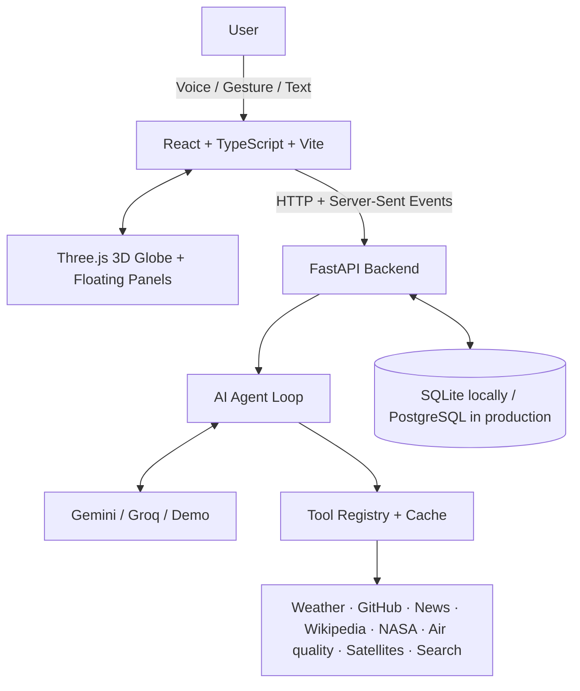

<div align="center">

# 🌌 Aura — Multimodal AI Assistant

### **Talk. Gesture. Type. Explore.**

An AI assistant that brings voice, hand gestures, text, live information, and an interactive 3D globe into one browser-based workspace.

[](https://aura-multimodal-ai-assistant-voice.vercel.app/)
[](https://aura-backend-s0mm.onrender.com/api/health)
[](https://aura-multimodal-ai-assistant-voice.vercel.app/)
[](https://aura-backend-s0mm.onrender.com/docs)

[**Try the live app**](https://aura-multimodal-ai-assistant-voice.vercel.app/) · [API health](https://aura-backend-s0mm.onrender.com/api/health) · [Interactive API docs](https://aura-backend-s0mm.onrender.com/docs) · [Architecture](docs/ARCHITECTURE.md)

</div>

---

## ✨ What is Aura?

Aura is a full-stack, multimodal AI assistant designed for more natural interaction. Ask a question by typing or speaking, use your webcam to control the interface with hand gestures, and explore results through floating information panels around a live 3D globe.

Behind the interface, a tool-using AI agent decides when to answer directly and when to retrieve live information from external data sources. Responses stream back to the browser, relevant panels open as tools finish, and Aura can read its answer aloud.

> **The idea:** make an AI assistant feel less like a text box and more like an interactive workspace.

## 🚀 Try Aura online

| Service | Link | What it does |
|---|---|---|
| **Live website** | [aura-multimodal-ai-assistant-voice.vercel.app](https://aura-multimodal-ai-assistant-voice.vercel.app/) | React interface, 3D globe, voice and gesture controls |
| **Backend health** | [ `/api/health` ](https://aura-backend-s0mm.onrender.com/api/health) | Confirms that the API is responding |
| **Backend configuration** | [ `/api/config` ](https://aura-backend-s0mm.onrender.com/api/config) | Shows the active provider and available tools/configuration status |
| **API documentation** | [ `/docs` ](https://aura-backend-s0mm.onrender.com/docs) | Interactive FastAPI / OpenAPI documentation |
| **Source code** | [GitHub repository](https://github.com/SanjayK075/Aura-Multimodal-AI-Assistant-Voice-gesture-and-Text-) | Application code, tests, documentation and deployment configuration |

*Note:* the hosted backend may take a little time to wake after inactivity on a free hosting plan. A cold start can make the first request slower than later requests.

## 🧩 Highlights

### 🗣️ Three ways to interact

- **Speech:** ask questions using browser speech recognition and hear answers through speech synthesis.
- **Hand gestures:** use a webcam and MediaPipe hand tracking to point, pinch, drag, resize, navigate and control interface elements.
- **Text and mouse:** type questions, click controls, drag panels and use standard keyboard/mouse interactions.
- **Mix modes naturally:** use whichever input feels most convenient for the task.

### 🌍 Live 3D workspace

- Interactive Three.js globe with location-aware results and space-related visuals.
- Floating panels for answers and tool results.
- Move, resize, pin, navigate or close panels using supported input modes.
- Conversation history and an activity log showing tool calls, results, sources and timing.

### 🧠 Tool-using AI agent

- An agent loop chooses tools when a question needs current or external information.
- Streaming responses let the interface show progress and results as they arrive.
- Gemini and Groq provider support, with automatic provider selection/fallback when configured.
- Demo mode remains available without an LLM key; live-data tools may still work, but general model answers require a configured provider.

### 🔎 Connected data sources

| Capability | Source |
|---|---|
| Weather and forecast | [Open-Meteo](https://open-meteo.com/) |
| GitHub users, repositories and issues | [GitHub REST API](https://docs.github.com/en/rest) |
| News | [Google News RSS](https://news.google.com/) |
| Encyclopedic summaries | [Wikipedia](https://www.wikipedia.org/) |
| Astronomy Picture of the Day | [NASA APOD](https://apod.nasa.gov/apod/astropix.html) |
| Air quality and UV | [Open-Meteo air quality](https://open-meteo.com/en/docs/air-quality-api) |
| Satellites overhead | [CelesTrak](https://celestrak.org/) orbit data, positions computed in the browser |
| Web search | [Tavily](https://tavily.com/) if a key is set, otherwise DuckDuckGo and Wikipedia |
| Date and time | Backend system clock |

External services can change their availability, quotas, response formats or access policies. Some tools may be temporarily unavailable without preventing the rest of Aura from working.

### 🧭 Pages and the planning agent

Aura has a page for each job: Command, Agent, Earth, Satellites, Weather, Map, News, GitHub and Memory. Flip between them with the arrows, by waving an open hand sideways, or by saying "go to the map". For a request with several parts, the Agent page shows the plan the model made, each step as it runs (independent steps run in parallel, failed ones retry), and asks before anything that changes data, such as forgetting a memory. See [docs/ARCHITECTURE.md](docs/ARCHITECTURE.md).

## 🏗️ Architecture



### Stack at a glance

| Layer | Technologies |
|---|---|
| Frontend | React, TypeScript, Vite, Zustand |
| 3D and interaction | Three.js, React Three Fiber, MediaPipe Tasks Vision |
| Speech | Browser speech recognition and speech synthesis APIs |
| Backend | Python, FastAPI, Uvicorn, HTTPX |
| AI providers | Google Gemini, Groq, optional OpenAI-compatible endpoints |
| Data and persistence | External REST/RSS APIs, SQLAlchemy, SQLite locally, PostgreSQL in production |
| Tests | Pytest, Vitest, Testing Library / JSDOM |
| Deployment | Vercel (frontend), Render (backend), Neon (PostgreSQL) |

## 🖥️ Run locally

### Requirements

- **Python 3.11+** (Python 3.13 is supported by the provided Docker image)
- **Node.js 20.19+** and npm
- Chrome or Edge recommended for speech recognition and camera-based hand tracking
- A webcam and microphone for gesture and speech input; text and mouse controls work without them
- A key from [Google AI Studio](https://aistudio.google.com/apikey) or [Groq](https://console.groq.com/keys) for model-powered answers. Without a key, Aura can run in demo mode.

### Option A — Windows quick start

From the project root, run `setup.bat`, add a model key to `backend\.env`, then run `start.bat`.

If the scripts aren't suitable for your setup, use the manual instructions below.

### Option B — Manual setup

#### 1. Configure and start the backend

Open a terminal in the project root:

**Windows PowerShell**

```powershell
cd backend
python -m venv .venv
.\.venv\Scripts\Activate.ps1
python -m pip install -r requirements-dev.txt
Copy-Item .env.example .env
```

**macOS / Linux**

```bash
cd backend
python3 -m venv .venv
source .venv/bin/activate
python -m pip install -r requirements-dev.txt
cp .env.example .env
```

Edit `backend/.env` and add at least one model provider key. Then, from the `backend` directory with the virtual environment activated, start the API:

```bash
uvicorn app.main:app --reload --port 8000
```

The API runs at `http://localhost:8000`; interactive docs are at `http://localhost:8000/docs`.

#### 2. Start the frontend

Open a **second terminal** at the repository root:

```bash
cd frontend
npm install
npm run dev
```

Open [http://localhost:5173](http://localhost:5173). During local development, Vite proxies `/api` requests to `http://localhost:8000`.

#### 3. Check your configuration

With the backend virtual environment activated and the terminal in `backend`:

```bash
python -m app.doctor
```

The diagnostic checks configured model providers and the data-source integrations, reporting successes and failures. It can make real API requests, so provider keys and network access affect the results.

## 🔐 Environment variables

Copy `backend/.env.example` to `backend/.env`. The application reads backend settings from environment variables or that local `.env` file.

| Variable | Required? | Purpose |
|---|---|---|
| `LLM_PROVIDER` | No (`auto` by default) | `auto`, `gemini`, `groq`, `openai_compat` or `demo` |
| `GEMINI_API_KEY` | Optional, recommended | Gemini credentials from [Google AI Studio](https://aistudio.google.com/apikey) |
| `GEMINI_MODEL` | No | Gemini model identifier configured for this project |
| `GEMINI_THINKING_LEVEL` | No | Optional Gemini thinking level |
| `GROQ_API_KEY` | Optional | Groq credentials from [Groq Console](https://console.groq.com/keys) |
| `GROQ_MODEL` | No | Groq model identifier configured for this project |
| `GROQ_REASONING_EFFORT` | No | Optional Groq reasoning effort |
| `OPENAI_COMPAT_BASE_URL` | No | Optional base URL for an OpenAI-compatible API or local server |
| `OPENAI_COMPAT_API_KEY` | No | Optional key for that compatible provider |
| `OPENAI_COMPAT_MODEL` | No | Model name for the compatible provider |
| `GITHUB_TOKEN` | No | Optional token to increase GitHub API rate limits |
| `NASA_API_KEY` | No (`DEMO_KEY`) | NASA APOD API key; a personal key can have different quotas |
| `CONTACT_EMAIL` | No | Optional contact in the Wikipedia request User-Agent |
| `OFFLINE_SAMPLE_DATA` | No (`false`) | Use bundled sample data instead of live data when supported |
| `DATABASE_URL` | No locally | Defaults to SQLite; use a PostgreSQL connection URL in production |
| `CORS_ORIGINS` | No | Comma-separated browser origins allowed to call the API |
| `RATE_LIMIT_PER_MINUTE` | No (`20`) | Per-client request limit used by the backend |
| `LLM_MAX_OUTPUT_TOKENS` | No (`4096`) | Maximum model output-token budget |

A minimal local configuration can look like this:

```dotenv
LLM_PROVIDER=auto
GEMINI_API_KEY=your_gemini_key_here
GROQ_API_KEY=
GITHUB_TOKEN=
NASA_API_KEY=DEMO_KEY
DATABASE_URL=sqlite:///./aura.db
CORS_ORIGINS=http://localhost:5173,http://127.0.0.1:5173
RATE_LIMIT_PER_MINUTE=20
```

The values above are **placeholders/examples**. Use your own credentials in your local `.env` or your hosting provider's secret settings.

### Frontend environment

For production deployments where the frontend and backend are hosted on different domains, set `VITE_API_URL` in the frontend hosting dashboard to the backend's **base URL** (no trailing slash). For this deployment:

```dotenv
VITE_API_URL=https://aura-backend-s0mm.onrender.com
```

Locally, you can leave `VITE_API_URL` unset because Vite proxies `/api` to the local backend.

## ☁️ Deployment

The live deployment uses a split architecture:

- **Frontend:** [Vercel](https://vercel.com/) — [open Aura](https://aura-multimodal-ai-assistant-voice.vercel.app/)
- **Backend:** [Render](https://render.com/) — [health check](https://aura-backend-s0mm.onrender.com/api/health)
- **Database:** [Neon](https://neon.tech/) PostgreSQL

### Frontend on Vercel

| Setting | Value |
|---|---|
| Root directory | `frontend` |
| Framework preset | Vite |
| Build command | `npm run build` |
| Output directory | `dist` |
| Environment variable | `VITE_API_URL=https://aura-backend-s0mm.onrender.com` |

### Backend on Render

The root-level [`render.yaml`](render.yaml) defines the Blueprint for the FastAPI Docker service. It uses `backend/Dockerfile` and health-checks `/api/health`.

Set the following in Render's environment settings. Never store secret values in `render.yaml` or commit them to Git:

| Variable | Configuration |
|---|---|
| `LLM_PROVIDER` | `auto` |
| `GEMINI_API_KEY` | Secret value in Render dashboard |
| `GROQ_API_KEY` | Optional secret value in Render dashboard |
| `GITHUB_TOKEN` | Optional secret value in Render dashboard |
| `NASA_API_KEY` | `DEMO_KEY` by default |
| `DATABASE_URL` | PostgreSQL connection string from Neon |
| `CORS_ORIGINS` | `http://localhost:5173,https://aura-multimodal-ai-assistant-voice.vercel.app` |

If you use a different Vercel domain, replace the production origin with your actual site URL. Each origin should contain only the scheme, host and optional port—no path or trailing slash.

### Database

Local development defaults to SQLite (`aura.db`). The hosted backend uses PostgreSQL so conversation history can persist independently from the container filesystem. Keep your database connection string private and configure it as `DATABASE_URL` in Render.

For a complete deployment walkthrough, see [`docs/DEPLOYMENT.md`](docs/DEPLOYMENT.md).

## 🧪 Tests and evaluation

Run the backend tests from `backend` with its virtual environment active:

```bash
python -m pytest
```

Run the frontend tests and production build from `frontend`:

```bash
npm test
npm run build
```

The test suites cover agent and provider behavior, API handling, gestures, pointer interactions, voice-command parsing and interface state. They are designed to test behavior without needing a real webcam or making live model calls for every test.

### Optional: run the evaluation

The repository includes a 30-question evaluation script that reports task success, tool-selection accuracy and response timing. Start the backend with a configured model provider, then run from the `backend` directory:

```bash
python ../eval/run_eval.py
```

The script makes model/API calls and may take several minutes depending on provider latency and rate limits. Results are written under `eval/results/`.

## 🎛️ Using Aura

1. Open Aura in Chrome or Edge.
2. Allow camera and microphone access when prompted if you want hand and speech controls.
3. Set your city and GitHub username in **Settings** to personalize weather and repository requests.
4. Type or speak a question, or enable the camera for hand-based interaction.
5. Pin panels you want to keep; use the activity log to inspect tool calls and sources.

Examples to try:

- “What's the weather in Chennai?”
- “Show me the NASA picture of the day.”
- “Which satellites are above me?”
- “Compare the weather in Pune and Delhi, then recommend one.”
- “Remember that I prefer metric units.”
- “Show my GitHub repositories.”
- “Summarize the latest news about space.”

The app includes a Help panel with supported voice commands and gesture tips.

## 🛠️ Troubleshooting

| Symptom | Things to check |
|---|---|
| **Backend not responding** | Open the [health endpoint](https://aura-backend-s0mm.onrender.com/api/health); check Render logs and wait for a sleeping service to wake. Locally, make sure Uvicorn is running on port `8000`. |
| **CORS error in the browser** | Ensure `CORS_ORIGINS` contains the exact Vercel origin and local origin separated by commas; no trailing slash. Save/redeploy the Render service after changing it. |
| **Chat works locally but not on Vercel** | Check the Vercel `VITE_API_URL` value and redeploy after changing it—Vite embeds it at build time. |
| **Aura is in demo mode** | Add a valid `GEMINI_API_KEY` or `GROQ_API_KEY` to the backend environment, then restart/redeploy. Confirm the active provider at `/api/config`. |
| **Model/key/rate-limit error** | Check the selected model name and provider quota. Run `python -m app.doctor` locally for diagnostics. |
| **Conversation history disappears** | Confirm production `DATABASE_URL` points to your hosted PostgreSQL database, not the local SQLite default. |
| **Microphone doesn't work** | Use a supported browser, allow microphone permission, and check the browser's speech-recognition support and internet connection. |
| **Camera/gesture control doesn't work** | Use HTTPS or localhost, allow camera access, improve lighting, keep your hand inside the preview and tune **Pinch sensitivity** in Settings. |
| **Pinches trigger too easily or not at all** | Adjust the Pinch sensitivity setting. The gesture thresholds are maintained in `frontend/src/config/gestures.ts`. |

## 🔒 Security and privacy notes

- **Never commit secrets.** Keep backend keys, database URLs and tokens in `backend/.env` locally or in the hosting provider's secret manager. Commit only `.env.example` with empty/example values.
- The frontend only needs the public backend URL. **Do not put Gemini, Groq, GitHub or database secrets in `VITE_*` variables**; frontend environment values are bundled into browser-accessible code.
- Hand tracking is performed in the browser with MediaPipe; the camera stream is used to compute hand landmarks for interaction rather than being sent to Aura's backend. MediaPipe may collect usage diagnostics as described in its [privacy notice](https://goo.gle/mediapipe-privacy).
- Speech recognition and synthesis depend on the browser's implementation and permissions. Review your browser's own privacy behavior when enabling voice features.
- The public demo has no user-account system. The per-client rate limit is a basic safeguard, not a robust abuse-prevention boundary; use provider quotas and avoid credentials tied to paid usage you cannot monitor.

## 📚 Documentation

- [Architecture and API details](docs/ARCHITECTURE.md)
- [Design and code walkthrough](docs/WALKTHROUGH.md)
- [Deployment guide](docs/DEPLOYMENT.md)
- [Gesture thresholds](frontend/src/config/gestures.ts)
- [Backend configuration template](backend/.env.example)
- [Frontend configuration template](frontend/.env.example)

## 🗂️ Project structure

```text
.
├── backend/
│   ├── app/
│   │   ├── agent/          # Agent loop, prompts and follow-up logic
│   │   ├── llm/            # Gemini, Groq/OpenAI-compatible and demo providers
│   │   ├── tools/          # Data-source integrations and tool registry
│   │   ├── main.py         # FastAPI routes and streaming responses
│   │   ├── config.py       # Environment-driven settings
│   │   ├── db.py           # Conversation, message and tool-call storage
│   │   └── doctor.py       # Configuration and integration diagnostics
│   ├── tests/              # Backend tests
│   ├── Dockerfile
│   ├── requirements.txt
│   └── .env.example
├── frontend/
│   ├── src/
│   │   ├── components/     # Globe, panels, controls and camera preview
│   │   ├── lib/            # API, streaming, speech and gesture logic
│   │   ├── config/         # Gesture tuning
│   │   └── store/          # App state and layout
│   ├── scripts/            # MediaPipe asset helpers
│   ├── package.json
│   └── .env.example
├── docs/                   # Architecture, walkthrough and deployment docs
├── eval/                   # Question set and evaluation runner
├── render.yaml             # Render Blueprint
├── setup.bat               # Windows setup helper
└── start.bat               # Windows launch helper
```

## 🤝 Contributing

Bug reports, usability improvements, documentation fixes and thoughtful feature ideas are welcome.

1. Fork the repository.
2. Create a focused branch for your change.
3. Run the relevant backend/frontend tests and production build.
4. Open a pull request describing the change and how you tested it.

Please do not include credentials, `.env` files, database dumps, virtual environments or generated dependencies in pull requests.

## 📄 License

No license file is currently included. Unless a license is added to the repository, normal copyright applies and reuse rights are not granted by default.

---

<div align="center">

**Built by [Sanjay K](https://github.com/SanjayK075)**

[🌐 Live Demo](https://aura-multimodal-ai-assistant-voice.vercel.app/) · [💻 Repository](https://github.com/SanjayK075/Aura-Multimodal-AI-Assistant-Voice-gesture-and-Text-) · [⚙️ API Docs](https://aura-backend-s0mm.onrender.com/docs)

*Give Aura a try: ask a question, explore the globe, and experiment with voice or hand gestures.*

</div>
