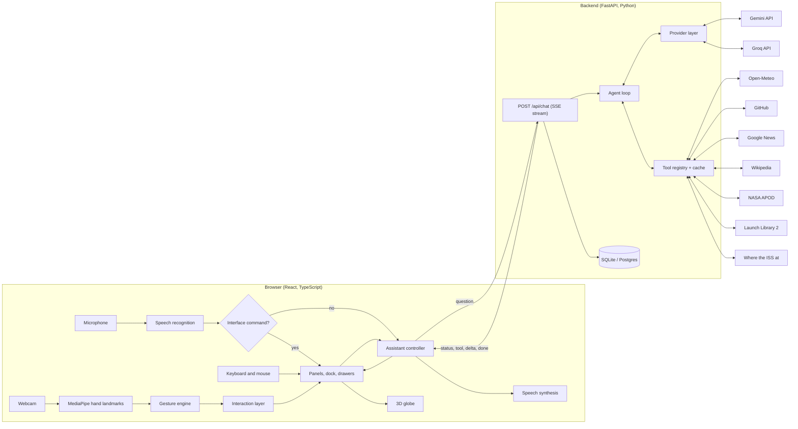

# Architecture

## The parts



The browser never talks to an LLM or a data source directly. API keys live only on the backend.

## What happens when you ask a question

Take "What's the weather in Chennai?" spoken aloud.

1. **Speech to text.** Chrome's speech recognition returns the sentence. `voiceCommands.ts` checks whether the whole phrase is an interface command such as "close that". It isn't, so it goes to `ask()` in `assistant.ts`.
2. **Request.** The browser sends `POST /api/chat` with the question, the conversation id and the user's preferences (default city, units, timezone). A random id generated once per browser is sent in the `X-Client-Id` header.
3. **Guard rails.** The backend checks the message length and the per-browser rate limit, loads the last 12 messages of the conversation, and saves the new question.
4. **Agent loop, step 1.** `run_agent` sends the system prompt, the history, the question and the nine tool definitions to the model. The model replies with a tool call: `get_weather({"city": "Chennai"})`.
5. **Tool.** The registry cleans the arguments, checks its cache, and runs the weather tool: one request to geocode "Chennai", one for the forecast. The result has two halves: a full `panel` for the screen and a compact `data` summary for the model.
6. **Stream.** A `tool` event carrying the panel goes to the browser immediately, so the weather panel opens before the model has said a word. The tool call is written to the activity log.
7. **Agent loop, step 2.** The compact data goes back to the model, which now answers in text. Each fragment is forwarded as a `delta` event.
8. **Done.** A `done` event carries the final text, timings, token counts and suggested follow-ups. The reply and its panels are saved.
9. **On screen.** The browser shows the text next to the panel, pins Chennai on the globe and turns it to face you, and reads the answer aloud. The microphone is paused while it speaks so it doesn't hear itself.

A general question such as "explain recursion" skips steps 5 and 6: the model answers directly and the text streams into an answer panel.

## Backend

| File | Responsibility |
|---|---|
| `app/main.py` | Routes, CORS, client identity, turning agent events into server-sent events, saving results |
| `app/config.py` | Every setting, from environment variables or `.env` |
| `app/agent/loop.py` | The agent loop. Knows nothing about HTTP, databases or specific providers |
| `app/agent/prompts.py` | The system prompt |
| `app/agent/followups.py` | Rule-based follow-up suggestions |
| `app/llm/base.py` | Provider-neutral message and event types, and `LLMError` |
| `app/llm/gemini.py` | Gemini over REST with streaming |
| `app/llm/openai_compat.py` | Groq and any other OpenAI-compatible server |
| `app/llm/demo.py` | Keyword router used when no key is set |
| `app/llm/__init__.py` | Chooses the provider; `FallbackProvider` chains several |
| `app/tools/__init__.py` | Tool registry, argument cleaning, caching, stale-on-error |
| `app/tools/*.py` | One module per data source |
| `app/db.py` | Tables and every query |
| `app/ratelimit.py` | Sliding-window rate limiter |
| `app/offline.py` | Sample data transport for offline use and tests |
| `app/doctor.py` | Setup checker |

### API

| Method and path | Purpose |
|---|---|
| `GET /api/health` | Liveness. Also what wakes a sleeping free host |
| `GET /api/config` | Active model, tool list, demo and sample-data flags |
| `POST /api/chat` | Ask a question. The response is a server-sent event stream |
| `GET /api/conversations` | This browser's conversations, newest first |
| `GET /api/conversations/{id}` | One conversation with messages and panels |
| `DELETE /api/conversations/{id}` | Delete one |
| `DELETE /api/conversations` | Delete everything for this browser |
| `GET /api/activity` | The tool-call log |
| `GET /api/space/iss` | Current ISS position, cached for five seconds |

Interactive documentation is generated by FastAPI at `http://localhost:8000/docs`.

### Events on the chat stream

| Event | Data | Meaning |
|---|---|---|
| `meta` | conversation id, provider, model | Sent first |
| `status` | `thinking`, `tool` (with a label) or `answering` | What the agent is doing |
| `tool` | name, arguments, ok, summary, duration, cached, source, panel | A tool finished |
| `delta` | text | The next fragment of the answer |
| `reset` | | Discard text shown so far: it preceded a tool call |
| `done` | text, steps, latency, tools, follow-ups, token usage | Finished |
| `error` | message, kind, retry-after | Failed, with a message fit to show |

### Data model

```
conversations   id, client_id, title, created_at, updated_at
messages        id, conversation_id, role, content, panels (JSON), meta (JSON), created_at
tool_calls      id, client_id, conversation_id, name, args (JSON), ok, summary,
                source, duration_ms, cached, created_at
```

`messages.panels` stores what each answer displayed, so reopening a conversation restores its panels without calling any API again. `messages.meta` holds the model, latency, token usage and a short record of the tools used, which is replayed to the model as context on later turns.

### Tools

| Tool | Source | Cached for |
|---|---|---|
| `get_weather` | Open-Meteo (geocoding + forecast) | 10 minutes |
| `github_user_repos` | GitHub REST API | 3 minutes |
| `github_repo_issues` | GitHub REST API | 3 minutes |
| `get_news` | Google News RSS | 5 minutes |
| `wikipedia_summary` | Wikipedia search + REST summary | 1 hour |
| `get_space_picture` | NASA APOD | 1 hour |
| `get_upcoming_launches` | Launch Library 2 | 30 minutes |
| `get_iss_position` | Where the ISS at, falling back to Open Notify | 5 seconds |
| `get_datetime` | System clock | not cached |

## Frontend

| File | Responsibility |
|---|---|
| `lib/gestures.ts` | 21 hand landmarks in, cursor position and pinch/palm state out. No browser dependencies |
| `lib/oneEuro.ts` | The smoothing filter for the cursor |
| `lib/interaction.ts` | Hover, click, drag, two-hand zoom and palm-dismiss, expressed against a small host interface |
| `lib/handTracker.ts` | Webcam, MediaPipe, the frame loop, the preview overlay, and the real host |
| `lib/speech.ts` | Wrappers over speech recognition and synthesis |
| `lib/voiceCommands.ts` | The spoken interface-command grammar |
| `lib/assistant.ts` | `ask()`, applying stream events, speaking, running commands |
| `lib/api.ts`, `lib/sse.ts` | HTTP calls and the stream parser |
| `lib/markdown.tsx` | Safe Markdown renderer for answers |
| `lib/geo.ts`, `lib/globeControl.ts` | Globe maths and orientation |
| `store/useStore.ts` | All state: panels, settings, status, conversation |
| `store/layout.ts` | Where panels go |
| `components/Scene.tsx` | The globe, markers, the ISS and its trail |
| `components/Panel.tsx`, `components/panels/*` | The panel frame and the six kinds of content |
| `components/Dock.tsx`, `TopBar.tsx`, `drawers/*` | Controls |

Three kinds of code touch state: React components subscribe to slices of the Zustand store; non-React code (hand tracking, voice, the stream) calls `useStore.getState()`; and the globe's orientation, which changes every frame, lives in a plain object (`globeControl`) read directly by the render loop so React isn't re-rendered 60 times a second.
